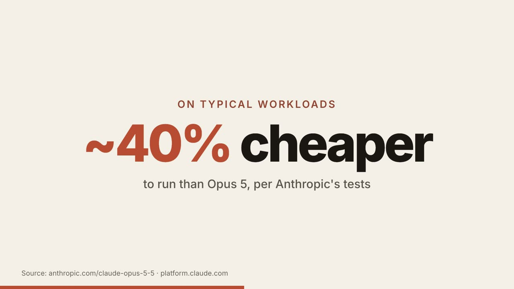

# opus-video-recipes

Videos made with **Claude Opus 5.5**. Every recipe ships the real rendered MP4, the exact prompt, what the agent did, render time and, where it could be measured, the token cost. No invented numbers.

Full guide with embedded videos: **[How to make videos with Claude Opus 5.5](https://bilallabs.vercel.app/ai/opus-video)**

| Recipe | Framework | Video | Prompt + notes |
|---|---|---|---|
| App Store preview video with one prompt | Remotion | [](https://bilallabs.vercel.app/ai/opus-video/lovely-app-store-preview-iphone.mp4) | [app-store-preview/](app-store-preview) · [page](https://bilallabs.vercel.app/ai/opus-video/app-store-preview-video) |
| Kinetic typography explainer: what's new in Opus 5.5 | HyperFrames | [](kinetic-typography-explainer/out.mp4) | [kinetic-typography-explainer/](kinetic-typography-explainer) · [page](https://bilallabs.vercel.app/ai/opus-video/kinetic-typography-explainer) |
| Captioned vertical clip with local TTS voiceover | HyperFrames | [](captioned-vertical-clip/out.mp4) | [captioned-vertical-clip/](captioned-vertical-clip) · [page](https://bilallabs.vercel.app/ai/opus-video/captioned-vertical-video-tts) |

Click a poster to play the MP4.

## Run a HyperFrames recipe

Needs Node.js 22+ and FFmpeg.

```bash
cd kinetic-typography-explainer
npx hyperframes check
npx hyperframes render --quality delivery --output out.mp4
```

To let your agent write new ones: `npx skills add heygen-com/hyperframes` (Claude Code, Cursor and others).

## Which framework?

[HyperFrames vs Remotion vs Manim for Claude-made videos](https://bilallabs.vercel.app/ai/opus-video/hyperframes-vs-remotion-vs-manim)

## Model facts

`claude-opus-5-5`, released 2026-09-22. $4 / $20 per million input / output tokens, $0.20 per million cache reads, 1M context, 128K max output. Source: [platform.claude.com](https://platform.claude.com/docs/en/about-claude/models/overview).

## License

Code and prompts: MIT. The Lovely app screens and demo photos in the preview video belong to the Lovely app and are not covered by the license.

Made by [Bilal Demirer](https://bilallabs.vercel.app). More: [subagent examples for Claude Code and Cursor](https://bilallabs.vercel.app/ai/subagents).
