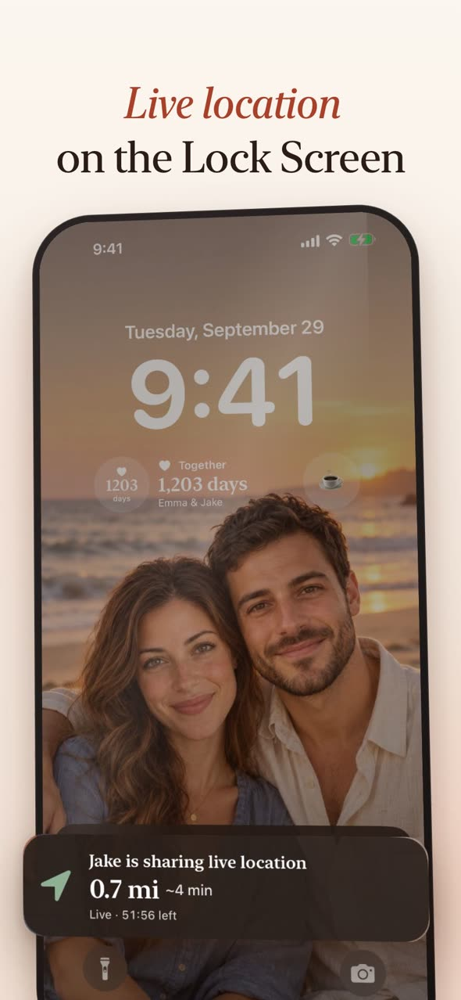
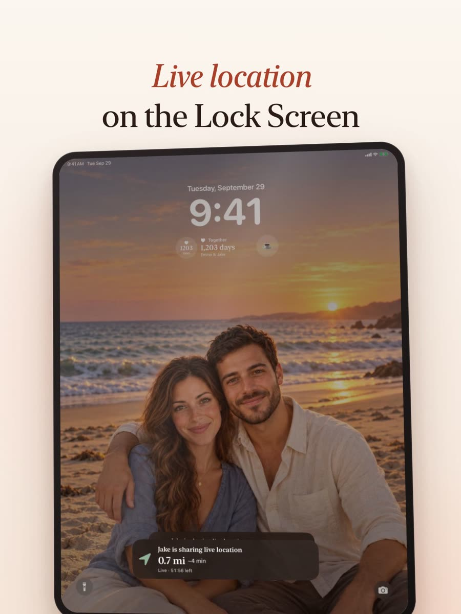

# App Store preview video with one prompt (Claude Opus 5.5 + Remotion)

The US App Store preview for my couples app Lovely, iPhone and iPad, from one prompt to Claude Opus 5.5 in Claude Code.

[](https://bilallabs.vercel.app/ai/opus-video/lovely-app-store-preview-iphone.mp4) [](https://bilallabs.vercel.app/ai/opus-video/lovely-app-store-preview-ipad.mp4)

Watch on the site: [https://bilallabs.vercel.app/ai/opus-video/app-store-preview-video](https://bilallabs.vercel.app/ai/opus-video/app-store-preview-video)

## The prompt (exact, typos included)

```
simdi us  icin gereken her icerigi verdim, us store gorselelriin ve videosunu hazirlayabilir miins? baska eksik va rmi?
```

Plus 12 attached images (the US demo couple's photos). In English: *"I've now given you everything needed for the US. Can you prepare the US store screenshots and video? Is anything else missing?"*

**Context, honestly:** the prompt is short because the project already had a pipeline built earlier with the same model: a brief ([BRIEF.md](BRIEF.md)), a Remotion composition for the Turkish preview, and iOS Simulator capture scripts. This prompt turned it into a new locale. Starting from zero, write a brief first.

## What the agent did

1. Read the marketing pipeline: demo seed data, simulator capture scripts, SwiftUI marketing scenes.
2. Saved the 12 photos as per-locale assets; changed the seed and scene code to load photos by locale.
3. Wrote en-US App Store metadata (name, subtitle, keywords).
4. Ran the capture pipeline for en-US, noticed a Turkish date in the iPad status bar, made the script set the simulator language per locale, captured again.
5. Copied the English screens into the Remotion project and switched the copy to English.
6. Checked frames, found empty map-pin crops (US places sit elsewhere on the map), added English pin coordinates.
7. Rendered iPhone (886×1920) and iPad (1200×1600), verified with ffprobe, updated CLAUDE.md.

## Measured (from the Claude Code session log)

| | |
|---|---|
| Model | claude-opus-5-5 |
| Wall-clock | 40.5 min, prompt to both files (~33 min was simulator capture) |
| Model calls | 83 |
| Tokens | 43,592 output · 170 uncached input · 11,255,497 cache read · 242,290 cache write (1h) |
| Cost at API list price | ≈ $5.06 ($0.87 output + $2.25 cache read + $1.94 cache write), covers screenshots and both videos |
| iPhone file | 886×1920, 30 fps, H.264 + AAC, 25.0 s, 17.4 MB |
| iPad file | 1200×1600, 30 fps, H.264 + AAC, 25.0 s, 14.9 MB |

## Apple's App Preview rules

From [App Store Connect: App preview specifications](https://developer.apple.com/help/app-store-connect/reference/app-information/app-preview-specifications/):

- 15–30 seconds, max 30 fps, max 500 MB, H.264 or ProRes 422 HQ, .mov / .m4v / .mp4.
- iPhone 6.9" / 6.5": 886×1920 portrait. iPad 13": 1200×1600 portrait.
- Default poster frame: 5 seconds. Audio optional; Apple lists stereo 256 kbps AAC.
- Use real captures of the app. No "Download" call to action, prices or ranking claims.

## Source

The Remotion composition and the app's capture scripts live in private projects, so they are not in this repo. [BRIEF.md](BRIEF.md) is the brief the first (Turkish) cut was built from, translated to English.
