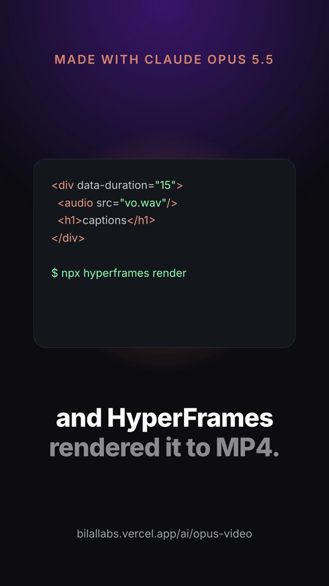

# Captioned vertical clip with local TTS voiceover (HyperFrames)

[](out.mp4)

15 s, 1080×1920, 30 fps, with sound. Voice, transcription and render all run locally. [Watch on the site](https://bilallabs.vercel.app/ai/opus-video/captioned-vertical-video-tts).

## Prompt to reproduce

```
Make a 15-second 1080×1920 vertical clip with HyperFrames from this script: "I made this video without opening a video editor. I gave Claude Opus 5.5 one prompt. It wrote HTML, and HyperFrames rendered it to MP4. The captions, the voice, the motion. All local. Here is the exact recipe." Generate the voiceover locally, get word timestamps with npx hyperframes transcribe, and show big centered captions in the lower third, 3–6 words per group, highlighting each word as it is spoken. Above them, a code card whose lines fade in. Dark background, one warm accent. Run check, then render.
```

## Steps

```bash
say -v Samantha -r 175 -o assets/vo.aiff "<script>"      # macOS built-in voice
ffmpeg -i assets/vo.aiff -ar 44100 assets/vo.wav
npx hyperframes transcribe assets/vo.wav --language en  # whisper.cpp small.en -> assets/transcript.json
npx hyperframes check
npx hyperframes render --quality delivery --output out.mp4
```

- HyperFrames' Kokoro TTS (`npx hyperframes tts`) needs `pip install kokoro-onnx soundfile`, which failed on the old system Python here, so the built-in macOS voice was used.
- Whisper heard "5.5 one" as "5.51"; that word was fixed by hand in the `W` array.
- Every `<audio>` needs an `id`, or the render is silent.

## Measured

- `npx hyperframes check`: passed, 84/84 contrast checks.
- Render: **14.5 s** on an M4 MacBook, hardware GPU. Output 1.6 MB.
- Tokens / cost: **not measured.** Built by Claude Opus 5.5 inside a longer multi-task agent session in Cursor with no per-recipe token counter.
